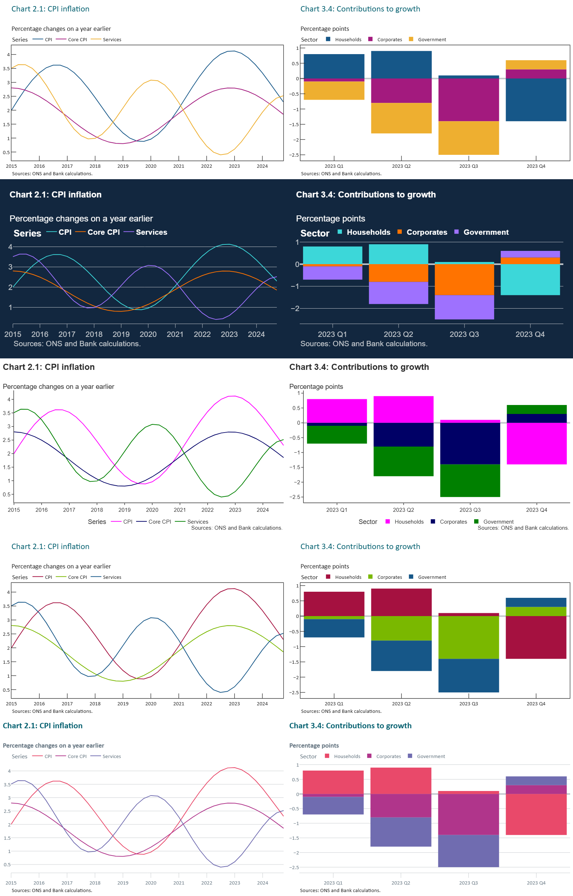

# boePlotlyPy

Bank of England chart styles and colour palettes for [Plotly](https://plotly.com/python/):
a Python counterpart to the R package
[boeCharts](https://github.com/bank-of-england/boeCharts).

## Themes

| Template | Matches boeCharts' | Look |
|---|---|---|
| `boe_mpr` | `theme_mpr()` | Monetary Policy Report: boxed plot area, inward ticks, teal title |
| `boe_fsr` | `theme_fsr()` | Financial Stability Report: MPR look with the FSR palette |
| `boe_overground` | `theme_overground()` | Bank Overground: bold teal title, horizontal gridlines |
| `boe_identity` | `theme_boe_identity()` | Bank visual identity: dark navy, white bold text |
| `boe_mcg` | `theme_mcg_pub()` | Classic axes, legend centred below |



## Install

```bash
pip install boePlotlyPy
```

Or, with [uv](https://docs.astral.sh/uv/) for local development:

```bash
uv sync
```

The import name is `boeplotlypy`.

## Quick start

Build a chart with Plotly as usual, then format it in one call:

```python
import boeplotlypy as boe
import plotly.express as px

fig = px.line(df, x="date", y="value", color="series")

boe.apply_formatting(
    fig,
    theme="boe_mpr",                                    # which BoE style
    title="Chart 2.1: CPI inflation has fallen back",   # chart title, top left
    subtitle="Percentage changes on a year earlier",    # line under the title (units)
    source="Sources: ONS and Bank calculations.",       # source note under the chart
    palette="vibrant_a",                                # series colours (a BoE palette)
    legend="top-left",                                  # legend position
    grid="X",                                           # horizontal gridlines only
    axis="X",                                           # draw the x-axis line
    hline0=True,                                        # strong line at zero
)
fig.show()
```

Every argument is optional: leave one out to keep the theme's default. Alternatively,
set the theme when building the figure (`px.line(..., template="boe_mpr")`), or for
the whole session (`plotly.io.templates.default = "boe_mpr"`).

### `apply_formatting` arguments

| Argument | What it does | Example values |
|---|---|---|
| `theme` | Applies a Bank of England style, including its colours | `"boe_mpr"`, `"boe_fsr"`, `"boe_overground"`, `"boe_identity"`, `"boe_mcg"` |
| `title` | The chart title, top left in the theme's title style | `"Chart 2.1: CPI inflation"` |
| `subtitle` | The line under the title, usually the units | `"Per cent"` |
| `source` | The source note printed under the chart (text for the reader, not a data or colour source) | `"Sources: ONS and Bank calculations."` |
| `palette` | Recolours the series with a named BoE palette or your own colours. A series repeated across facets keeps one colour; heatmap-style colour scales are rebuilt from the same palette. Warns if there are more series than colours | `"vibrant_a"`, `"boe"`, `["#A51140", "#165788"]` |
| `legend` | Where the legend goes | `"top-left"`, `"top-right"`, `"top"`, `"bottom-left"`, `"bottom-right"`, `"bottom"`, `"left"`, `"right"`, `"none"` |
| `grid` | Which gridlines to show, using boeCharts' convention: `"X"` gives **horizontal** lines, `"Y"` vertical lines, lowercase adds minor lines | `"X"`, `"Y"`, `"XY"`, `True`, `False` |
| `axis` | Which axis lines (and ticks) to draw | `"X"`, `"Y"`, `"XY"`, `True`, `False` |
| `hline0` | A strong horizontal line at zero, with zero always in view (boeCharts' `add_hline0()`) | `True`, `False`, `{"colour": "#1E1E1E", "width": 3}` |

The function changes the figure in place and returns it, so you can chain calls:
`boe.apply_formatting(px.bar(...), theme="boe_fsr").show()`.

### Further customisation

The result is an ordinary Plotly figure, so anything `apply_formatting` doesn't cover
is standard Plotly. Make these changes **after** `apply_formatting`, and they take
priority:

```python
fig.update_layout(
    yaxis_side="right",         # value axis on the right, as in many BoE charts
    yaxis_ticksuffix="%",       # units on the tick labels
    xaxis_title=None,           # remove axis titles (BoE charts usually omit them)
    yaxis_title=None,
    width=800, height=500,      # fixed size; or autosize=True to fill the container
    margin=dict(r=60),          # extra room on the right
)
fig.update_xaxes(dtick="M12", tickformat="%Y", ticklabelstandoff=8)   # yearly ticks, offset from the axis
fig.update_yaxes(range=[-2, 6])                                         # fix the axis range
fig.update_traces(line_width=3)                                         # thicker lines
fig.add_vline(x="2020-03-01", line_dash="dot")                          # mark an event
```

Things to know about order:

- Calling `apply_formatting` again re-applies whatever you pass it. For example,
  `palette=` recolours the series again, overwriting colours you set by hand.
- The space for the `source` line is worked out from the figure as it is when you
  call `apply_formatting`. If you then add or remove axis titles, or change the
  height of a chart that has a bottom legend, call `apply_formatting(fig, source=...)`
  again (or do those changes first).

### Fonts

The Calibri-based themes (MPR, FSR, Overground) fall back to the bundled
[Carlito](https://github.com/googlefonts/carlito), which has the same metrics, when
Calibri isn't installed. In a notebook, call `boe.enable_fonts()` once to make the
bundled fonts available to the browser. For static image export with kaleido, install
the `.ttf` files in [`src/boeplotlypy/fonts/`](src/boeplotlypy/fonts/) to your OS.

List the themes this package registered:

```python
print(boe.registered_themes())
```

## Palettes

All 42 boeCharts colour palettes are available as plain data:

```python
boe.PALETTES["vibrant_a"]        # ('#00294E', '#E9496A', '#FAD0C5')
boe.PALETTE_GROUPS["diverging"]  # ('red_blue', 'red_green', ...)

# Categorical colours for Plotly Express
fig = px.bar(df, x="quarter", y="value", color="sector",
             color_discrete_sequence=boe.PALETTES["boe"])

# Continuous colours (interpolated in Lab colour space, as boeCharts does)
fig = px.imshow(matrix, color_continuous_scale=boe.palettes.colorscale("red_blue"))
```

## Adding a new theme

Themes are auto-discovered, so adding one is just dropping a file into
[`src/boeplotlypy/themes/`](src/boeplotlypy/themes/). A Bank of England theme lists
only the settings where it differs from the defaults in
[`themes/_boe.py`](src/boeplotlypy/themes/_boe.py), which mirror the boeCharts
`theme_*()` arguments:

```python
# src/boeplotlypy/themes/boe_new_style.py
from ._boe import boe_template

NAME = "boe_new_style"                  # the name to use as template=...
TEMPLATE = boe_template(NAME, {"palette": "vibrant_b", "grid": "X", "legend": "bottom"})
```

`import boeplotlypy` will find and register it automatically. To add a palette, add
an entry to `_DEFINITIONS` in [`palettes.py`](src/boeplotlypy/palettes.py). See
[docs/dev_notes.md](docs/dev_notes.md) for how the code fits together.

## Development

```bash
uv run pytest                          # everything (about a minute)
uv run pytest -m "not render"          # fast tests only (no browser needed)
uv run pytest -m visual                # compare renders with the saved baseline images
uv run pytest -m visual --update-baselines   # refresh baselines after an intended visual change
uv run python scripts/generate_previews.py   # rebuild docs/images/boe_themes.png
```

The tests run every theme against about 35 chart types (line, bar, area, scatter,
histogram, box, violin, heatmap, contour, pie, sunburst, treemap, waterfall, OHLC,
facets, secondary axes, 3D, polar, ternary, maps and more), 16 awkward datasets (dates
of different frequencies and timezones, categories, gaps, negative, huge and tiny
values, many series) and every legend position. Tests marked `render` check what
plotly.js actually draws, via kaleido, and need Chrome or Edge. The chart catalogue and
datasets are in [tests/conftest.py](tests/conftest.py): add a chart or dataset there and
every matrix test picks it up.

## License

MIT
